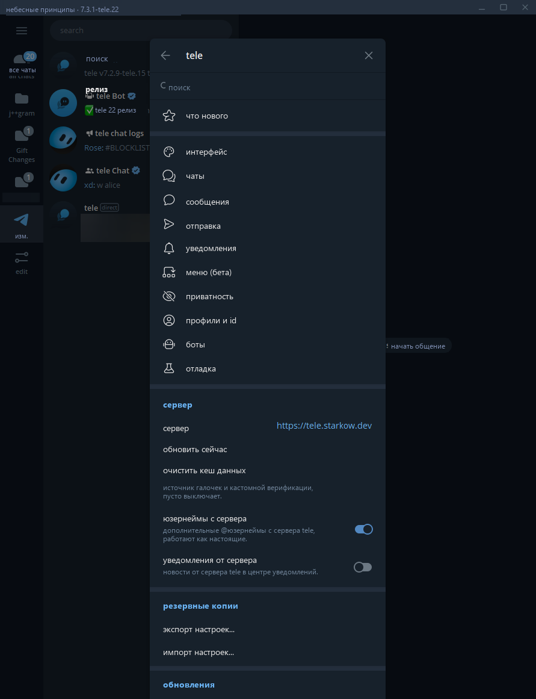

# tele

## teleru — русская сборка

**teleru** — это русская сборка [tele](https://github.com/nitreojs/tele). Она синхронизируется с актуальными релизами tele и обеспечивает полный перевод интерфейса, контекстных меню и настроек на русский язык, грамматически корректное склонение числительных (1 / 2 / 5), строгий автоматический аудит строк в CI и собственный независимый канал криптографически подписанных обновлений (Ed25519).

Свежие готовые сборки для Windows доступны на странице [релизов teleru](https://github.com/Duerotator/teleru/releases/latest).

---

форк telegram desktop: очередь патчей, которые применяются поверх каждого стабильного релиза [tdesktop](https://github.com/telegramdesktop/tdesktop) и автоматически собираются здесь.



## загрузка

загрузите последнюю сборку из [релизов](https://github.com/Duerotator/teleru/releases/latest). она никак не затрагивает установленный telegram или его данные.

| платформа | файл | описание |
|---|---|---|
| windows x64 | `tele-<версия>-win64.zip` | распакуйте архив в любое место и запустите `tele.exe`. приложение хранит свои данные рядом с exe (в папке `tdata`) и добавляет ярлык в меню «Пуск». |

tele обновляется самостоятельно: клиент проверяет наличие новых релизов каждые 3 часа, скачивает обновления в фоновом режиме и предлагает перезапустить приложение. канал обновлений подписан криптографическим ключом, поэтому неподписанная или сторонняя сборка не будет установлена. автообновление можно отключить в: настройки → tele → обновления.

каждый архив имеет подтверждение подлинности сборки ([build provenance attestation](https://github.com/Duerotator/teleru/attestations)). проверить подлинность загруженного файла можно через [github cli](https://cli.github.com):

```bash
gh attestation verify tele-<версия>-win64.zip --repo Duerotator/teleru
```

## главное

всё, что добавляет tele, находится в: **настройки → tele**, прямо под выбором языка.

- [студия подарков](docs/features.md#gift-studio): создание любых коллекционных предметов из настоящих деталей с экспортом в png, mp4, gif или стикер tgs.
- [режим невидимки](docs/features.md#privacy): чтение сообщений без отметок о прочтении, скрытие статуса «печатает», времени захода в сеть и просмотра историй — для всех чатов или выборочно.
- [центр уведомлений](docs/features.md#notifications): тосты tele, обновления, отчеты о падениях и уведомления сервера в едином списке.
- [консоль mtproto](docs/features.md#debug): вызов любых методов API под собственной сессией с автодополнением и подсказками схемы.
- [скрипты](docs/scripting.md): плагины на javascript и typescript с доступом ко всему API telegram, веб-платформе и собственным окнам tele с подтверждением разрешений. готовые скрипты доступны в [каталоге](https://gettele.app/scripting/catalog).
- [дизайны карт money](docs/features.md#chats): оформление карты money в стиле одного из ваших коллекционных подарков со стикерами.
- [сохранение удалённых сообщений](docs/features.md#messages): сообщения, удалённые другими пользователями, остаются в чате (по желанию сохраняются даже после перезапуска).
- [локальные папки и закрепления](docs/features.md#interface): больше папок, чатов в папке и закреплённых диалогов, чем разрешает telegram, хранятся локально на этом устройстве.
- [прикрепление медиа](docs/features.md#sending): компоновка медиафайлов над полем ввода с отдельными подписями и сохранением в черновиках.
- [снимки](docs/features.md#menus): сохранение сообщений в виде картинок с фоном чата или без него.
- [цитаты с форматированием](docs/features.md#messages): цитирование части форматированного сообщения с ответом в расширенном редакторе.
- [подписи к стикерам](docs/features.md#chats): отправка стикеров с текстовой подписью и отображение текста под ними.
- [режим стримера](docs/features.md#privacy): скрытие tele от захвата экрана, скрытие имён и текста из уведомлений, а также номера телефона.
- [автообновление](docs/features.md#updates): криптографически подписанные обновления.

## подробнее

- [все функции](docs/features.md), сгруппированные по страницам настроек.
- [релизы](docs/releases.md): список каждого патча по версиям сборок.
- [флаги запуска](docs/launch-flags.md), отключающие сетевые функции tele на один запуск.
- [шаблоны заголовка окна](docs/title-template.md): все доступные переменные и модификаторы.
- [очистка ссылок](docs/link-cleaner.md): трекинговые параметры, удаляемые tele.
- [сервер tele](docs/server.md): функции собственного сервера и инструкция по запуску.
- [архитектура русской локализации](docs/teleru.md): детали наложения перевода, плюрализация и проверка в CI.
- [руководство для участников](CONTRIBUTING.md).

## благодарности

- [tdesktop](https://github.com/telegramdesktop/tdesktop), на базе которого собирается каждая сборка tele.
- [materialgram](https://github.com/kukuruzka165/materialgram) от kukuruzka165, другой форк tdesktop. оттуда заимствованы идеи: скрытие хвостиков сообщений и классические отступы пузырей, отсутствие обводки у больших эмодзи, выбор более 100 сообщений, показ участников онлайн в больших группах, дата загрузки в просмотрщике медиа, копирование ID владельца набора стикеров, улучшенное качество голосовых сообщений и сохранение их начала, меньшее сжатие фото, более тонкая кисть редактора фото, уменьшенный минимальный размер окна, ускоренный экспорт чатов и последовательное упоминание нескольких людей.
- [freshGram](https://github.com/Snowy-Fluffy/freshGram) от Snowy-Fluffy (объединяющий [AyuGram Desktop](https://github.com/AyuGram/AyuGramDesktop) и materialgram). прототип секретных чатов tele портирован из его секретных чатов, а также идеи: фильтрация поиска по типу сообщений, сохранение удалённых чатов и тем, подсмотр скрытого времени захода в сеть и скрытие баннеров дней рождения.
- [SPOwnerBot](https://github.com/arynyklas/SPOwnerBot) от arynyklas и [его форк](https://github.com/madrik1337/SPOwnerBot) от madrik1337 за определение владельцев наборов стикеров, включая ID более 8 миллиардов.

## участие в разработке

исправления ошибок, разрешение конфликтов и новые функции приветствуются. перед реализацией новой функции рекомендуется открыть issue. [CONTRIBUTING.md](CONTRIBUTING.md) описывает полный цикл разработки: подготовку исходников, сборку, тестирование, экспорт патчей и создание pull request.

- [docs/architecture.md](docs/architecture.md): очередь патчей, организация кода форка и работа CI.
- [docs/development.md](docs/development.md): сборка, безопасный запуск dev-версии и внесение изменений.
- [docs/conventions.md](docs/conventions.md): стиль кода, коммиты, гигиена патчей и правила приватности.
- [docs/releasing.md](docs/releasing.md): процесс сборки, подписи и публикации релизов.
- [AGENTS.md](AGENTS.md): правила для AI-ассистентов.
